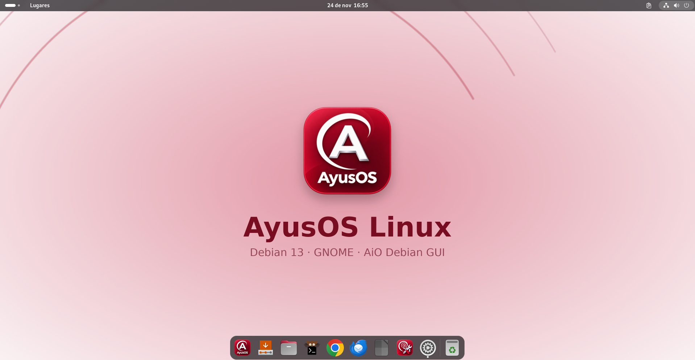
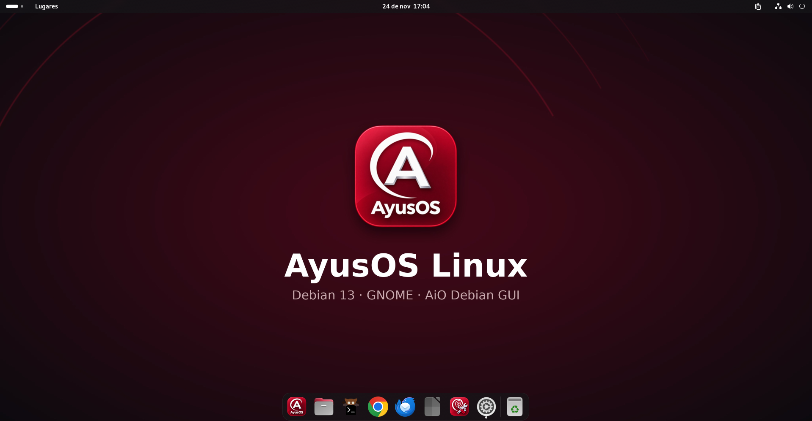
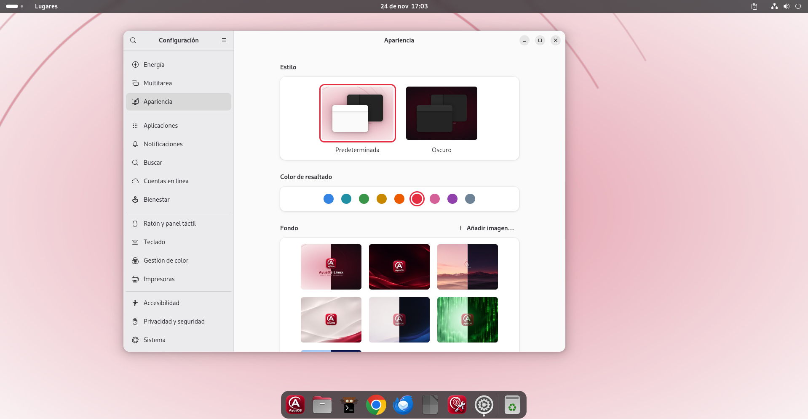
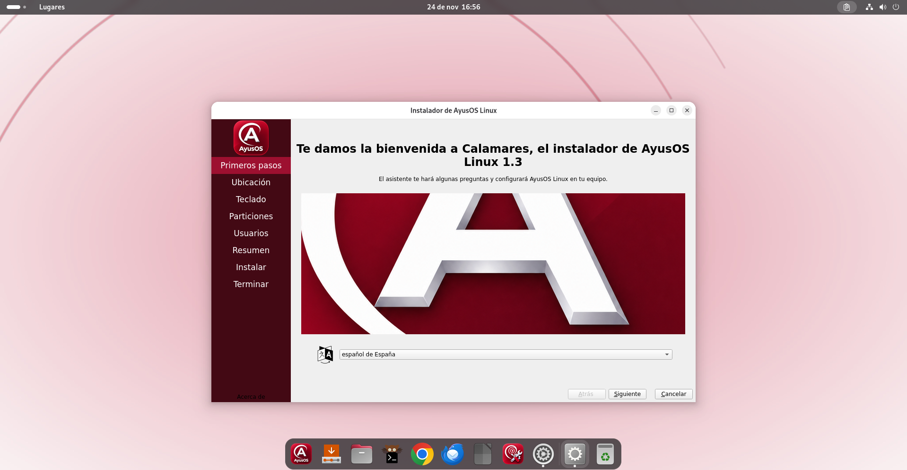
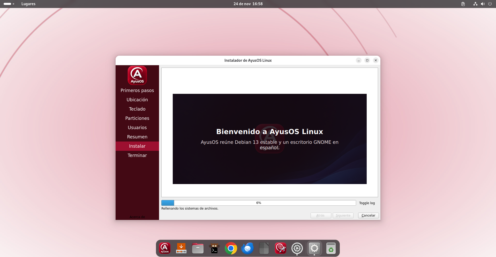
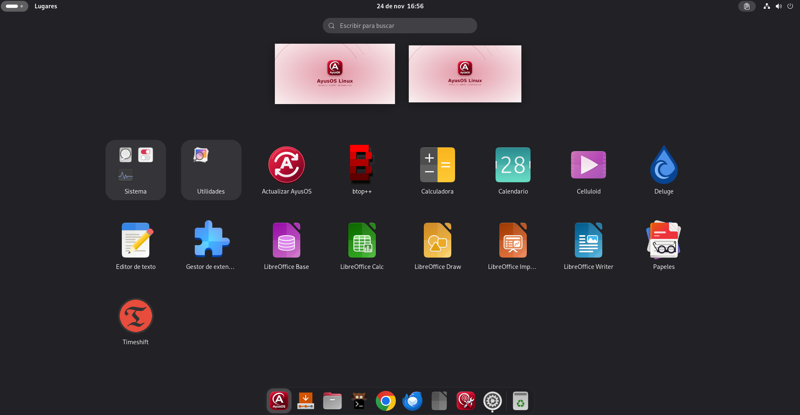
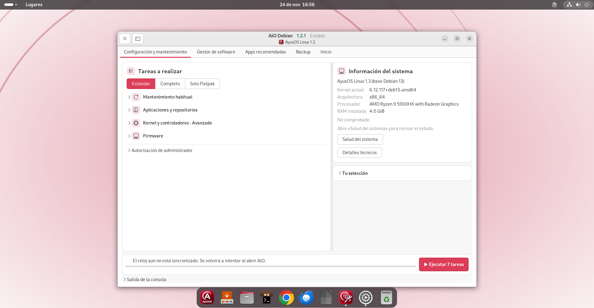

<div align="center">


# AyusOS Linux

**Debian 13 estable · GNOME en español · AiO Debian GUI**

Un escritorio para trabajar y una herramienta gráfica para mantenerlo. Arranca AyusOS desde un USB, explora GNOME y decide cuándo instalarlo.

**[Descargar AyusOS Linux 1.3 (amd64)](https://github.com/julioayusoalende-hue/AyusOS-Linux/releases/tag/v1.3)**

[Capturas](#ayusos-en-imágenes) · [El escritorio](#el-escritorio) · [AiO Debian GUI](#aio-debian-gui) · [Construir la ISO](#construir-la-iso)

</div>

---

## AyusOS en imágenes

[](docs/capturas/escritorio-claro.png)

| Modo oscuro | Ajustes de apariencia |
| --- | --- |
| [](docs/capturas/escritorio-oscuro.png) | [](docs/capturas/apariencia.png) |

| Bienvenida de Calamares | Recorrido durante la instalación |
| --- | --- |
| [](docs/capturas/calamares.png) | [](docs/capturas/recorrido-instalacion.png) |

<details>
<summary>Ver las aplicaciones y AiO Debian GUI</summary>

| Aplicaciones de GNOME | Panel de mantenimiento de AiO Debian GUI |
| --- | --- |
| [](docs/capturas/aplicaciones.png) | [](docs/capturas/aio-debian-gui.png) |

</details>

*Capturas de una compilación de prueba de la 1.3. En algunas se ve Kitty en el dock; la versión publicada incluye Terminal de GNOME.*

## Construir AyusOS Linux 1.2

La versión 1.2 parte de la ISO estable 1.1 con el icono del actualizador. Conserva Calamares y añade el recorrido durante la instalación y seis fondos claros y oscuros. La receta comprueba el SHA-256 de la ISO base antes de reconstruirla.

```bash
sudo apt install xorriso squashfs-tools
sudo ./remaster/crear-iso-recorrido.sh AyusOS-Linux-1.1-icono-actualizador-amd64.iso AyusOS-Linux-1.2-amd64.iso
sha256sum -c AyusOS-Linux-1.2-amd64.iso.sha256
```

## El escritorio

| Al iniciar AyusOS | Qué encontrarás |
| --- | --- |
| **Sesión GNOME** | Escritorio GNOME, inicio de sesión con GDM y conexiones de red gestionadas por NetworkManager. |
| **Español de España** | Sesión Live con teclado español, horario de Madrid y Firefox ESR con traducción al español. |
| **Base Debian 13** | Paquetes de Debian estable «trixie» y acceso al componente de firmware para hardware que lo necesita. |
| **Modo Live e instalación** | La ISO para PC Intel y AMD de 64 bits permite probar el escritorio en modo Live e instalarlo con Calamares. |

## AiO Debian GUI

AyusOS 1.3 incluye **AiO Debian GUI 1.2.1**. La receta de la 1.3 descarga en cada compilación la última versión estable publicada y comprueba su SHA-256 antes de incorporarla al sistema Live. La aplicación reconoce AyusOS y utiliza el icono de la distribución en su interfaz.


*Captura del proyecto AiO Debian GUI. La sección de mantenimiento reúne la actualización de paquetes y la limpieza del sistema.*

- **Antes de limpiar**, revisa la simulación de APT para ver qué paquetes propone retirar.
- **Si algo falla**, consulta el diagnóstico de APT y los servicios, o abre el historial de mantenimiento para revisar la ejecución.
- **Antes de cambiar el escritorio**, guarda una copia de los ajustes de GNOME y de los repositorios APT desde Backup.
- **Para automatizar el mantenimiento**, programa las tareas con systemd y consulta su resultado desde la aplicación.

<details>
<summary><strong>Ver la pantalla de copias de seguridad</strong></summary>


</details>

[Proyecto AiO Debian GUI y guía de uso](https://github.com/julioayusoalende-hue/AIO-Debian-GUI)

## Construir la ISO

Para la versión actual, consulta las [instrucciones de remasterización de AyusOS 1.3](https://github.com/julioayusoalende-hue/AyusOS-Linux/tree/v1.3#construir-la-iso), que parten de la ISO de AyusOS 1.2 y conservan Calamares.

<details>
<summary>Ver la receta histórica de compilación de la 0.1</summary>

En Debian 13 amd64, con conexión a Internet y espacio para el sistema descomprimido y la imagen, ejecuta:

```bash
sudo apt update
sudo apt install git live-build curl ca-certificates
git clone https://github.com/julioayusoalende-hue/AyusOS-Linux.git
cd AyusOS-Linux
sudo ./construir.sh
sha256sum -c AyusOS-Linux-0.1-amd64.iso.sha256
```

La imagen **AyusOS-Linux-0.1-amd64.iso** queda junto al script. Cada compilación utiliza su propio directorio `compilacion.*`. Si se interrumpe, entra en ese directorio y ejecuta `sudo lb clean --purge` antes de eliminarlo.

</details>

### Probar en GNOME Cajas

1. Crea una máquina virtual desde la ISO, asígnale 4 GB de RAM y arranca la sesión Live.
2. Comprueba el idioma, el teclado y el nombre de la distribución en **Configuración → Sistema → Acerca de**. Busca **AiO Debian GUI** en la vista de aplicaciones y abre su diagnóstico.
3. Para probar la instalación, arranca la sesión Live, abre **Instalar AyusOS** y selecciona un disco virtual vacío. Expulsa la ISO y verifica que GNOME arranca desde el disco.

### Personalizar la imagen

La [lista de paquetes](config/package-lists/escritorio.list.chroot) define las aplicaciones del escritorio. El [script de configuración](config/hooks/live/0900-ayusos.hook.chroot) establece la identidad de AyusOS y el idioma.
